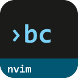
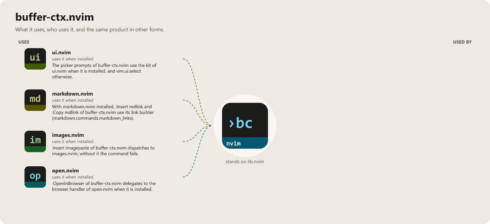

> **Beta stage — active development.** This repository is past its first shape and in
> active use, but the surface is not frozen: breaking changes are still possible. Pin a
> commit or tag if you depend on it.

# buffer-ctx.nvim

```
██████╗ ██╗   ██╗███████╗███████╗███████╗██████╗      ██████╗████████╗██╗  ██╗
██╔══██╗██║   ██║██╔════╝██╔════╝██╔════╝██╔══██╗    ██╔════╝╚══██╔══╝╚██╗██╔╝
██████╔╝██║   ██║█████╗  █████╗  █████╗  ██████╔╝    ██║        ██║    ╚███╔╝
██╔══██╗██║   ██║██╔══╝  ██╔══╝  ██╔══╝  ██╔══██╗    ██║        ██║    ██╔██╗
██████╔╝╚██████╔╝██║     ██║     ███████╗██║  ██║    ╚██████╗   ██║   ██╔╝ ██╗
╚═════╝  ╚═════╝ ╚═╝     ╚═╝     ╚══════╝╚═╝  ╚═╝     ╚═════╝   ╚═╝   ╚═╝  ╚═╝
                                                                   .nvim
```

[](LICENSE)
[](https://neovim.io)
[](https://www.lua.org)

[](https://github.com/WKDSteve/buffer-ctx.nvim/actions/workflows/ci.yml)
[](https://wkdsteve.github.io/wkd/p/buffer-ctx/)

> Part of the [wkd](https://wkdsteve.github.io/wkd/) family — see this plugin's [page](https://wkdsteve.github.io/wkd/p/buffer-ctx/) on the site.

Everything the current buffer already knows about itself, as text you can insert
or copy: its path, its Lua module name, the line you are on, a timestamp, a UUID,
an annotation, a boilerplate header.

---

## Documentation

Start at [docs/README.md](docs/README.md) — what's where, and which question
each page answers.

### The Basics

- [Requirements](docs/installation.md#requirements) — Neovim version, required and optional plugins.
- [Installation](docs/installation.md) — plugin managers and load-trigger variants.
- [Quickstart](docs/quickstart.md) — the first commands to run after installing.

### Using it

- [Configuration](docs/configuration.md) — every `setup()` option and its default.
- [Commands](docs/commands.md) — the four command trees, subcommand by subcommand.
- [Keymaps](docs/keymaps.md) — the keys, on one screen, and how to change them.
- [Bindings cheatsheet](docs/BINDINGS.md) — every keymap, user command and autocommand at a glance.
- [Features](docs/FEATURES/README.md) — one page per area: context, marks, annotations, templates, formatting.
- [Workflow](docs/WORKFLOW.md) — not what each subcommand does, but how they combine into a way of working.
- [Lua API](docs/api.md) — the `require("buffer_ctx")` surface a config or another plugin may call.

### The Rest

- [Around it](docs/around-it.md) — how this plugin's scope differs from its siblings in the collection.
- [Architecture](docs/architecture.md) — source tree layout and module responsibilities.
- [Health check](docs/health.md) — what `:checkhealth buffer_ctx` reports, section by section.
- [Contributing](docs/CONTRIBUTING.md) — ground rules and project layout.
- [Feedback](https://github.com/WKDSteve/buffer-ctx.nvim/issues) — bugs, features, questions.
- [Tests](TESTS/README.md) — how to run the spec suite.

`:help buffer-ctx` is the same reference inside the editor.

---

## License

MIT — see [LICENSE](LICENSE).

<!-- connections:begin (written by the app-icons tool of the workshop; change integrations.json there, not this block) -->
## Connections



**Uses**

- [images.nvim](https://github.com/WKDSteve/images.nvim): `:Insert imagepaste` of buffer-ctx.nvim dispatches to images.nvim; without it the command fails. ([picture](assets/graphs/pair/buffer-ctx.nvim--images.nvim.png))
- [markdown.nvim](https://github.com/WKDSteve/markdown.nvim): With markdown.nvim installed, `:Insert mdlink` and `:Copy mdlink` of buffer-ctx.nvim use its link builder (`markdown.commands.markdown_links`). ([picture](assets/graphs/pair/buffer-ctx.nvim--markdown.nvim.png))
- [open.nvim](https://github.com/WKDSteve/open.nvim): `:OpenInBrowser` of buffer-ctx.nvim delegates to the browser handler of open.nvim when it is installed. ([picture](assets/graphs/pair/buffer-ctx.nvim--open.nvim.png))
- [ui.nvim](https://github.com/WKDSteve/ui.nvim): The picker prompts of buffer-ctx.nvim use the kit of ui.nvim when it is installed, and `vim.ui.select` otherwise. ([picture](assets/graphs/pair/buffer-ctx.nvim--ui.nvim.png))
- [lib.nvim](https://github.com/WKDSteve/lib.nvim): the shared base of the plugins.
<!-- connections:end -->
